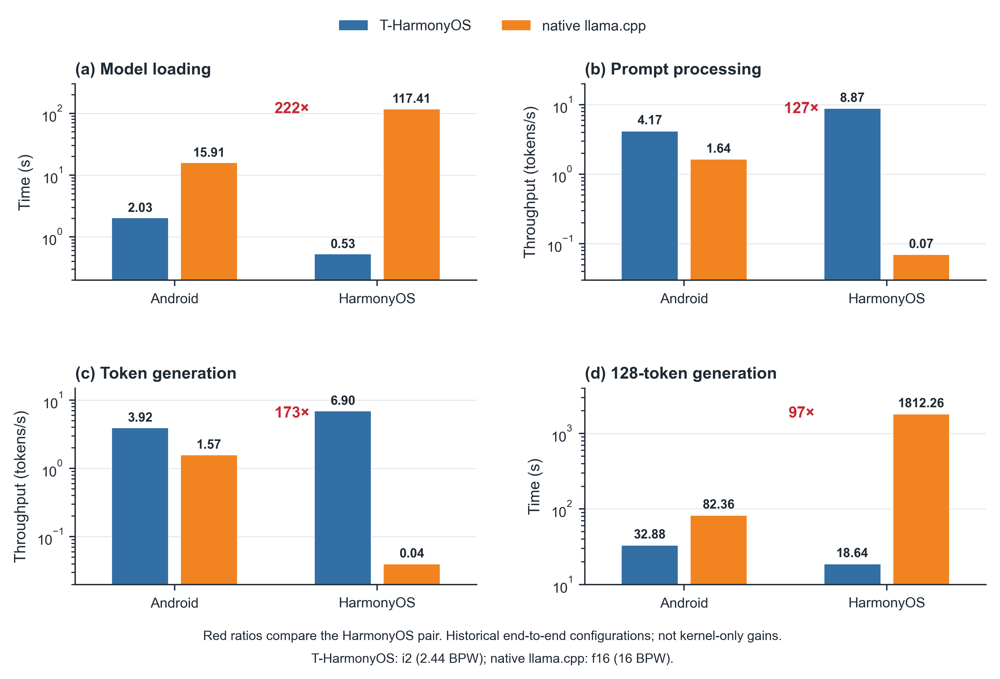
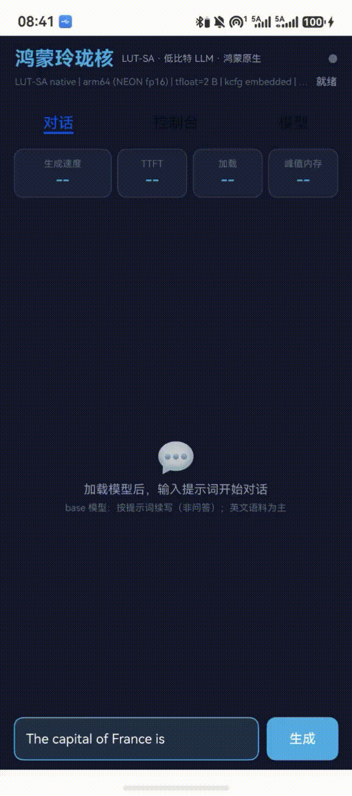
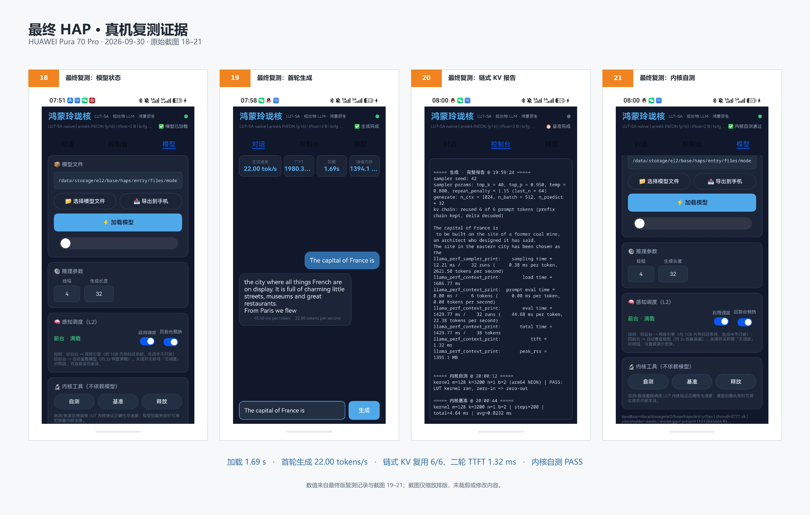
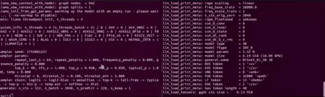
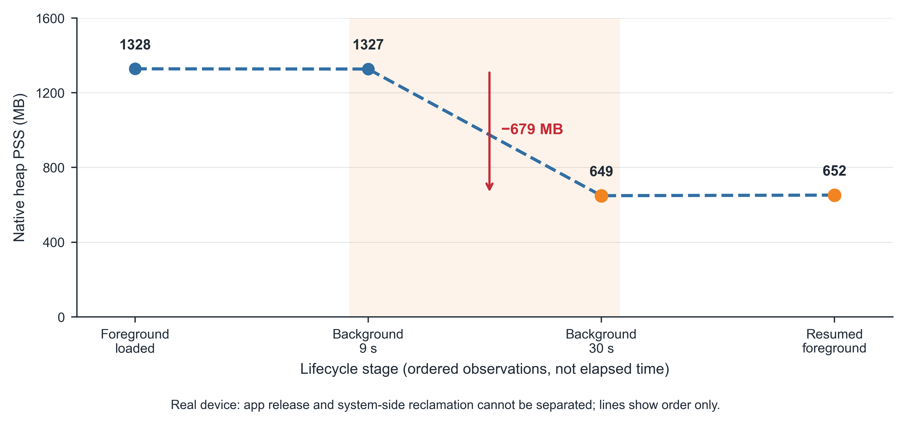
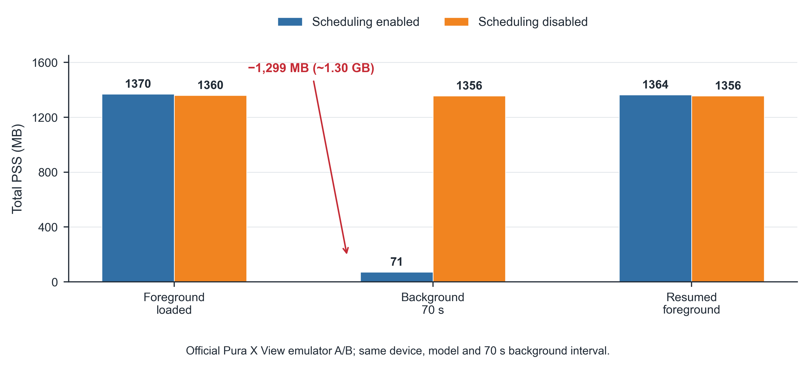
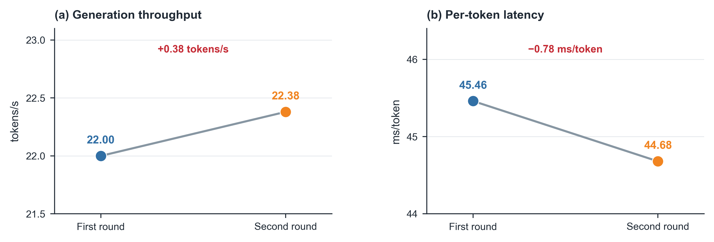
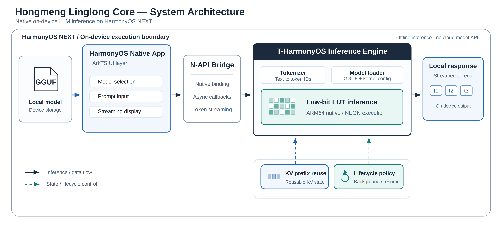

# 鸿蒙玲珑核 · Hongmeng Linglong Core

<p align="center">
  
</p>

<p align="center">
  <strong>Native On-device Low-bit LLM Inference for HarmonyOS NEXT</strong>
</p>

<p align="center">
  <em>让大模型挣脱云端束缚，让智能真正扎根鸿蒙终端。</em>
</p>

<p align="center">
  <code>HarmonyOS NEXT</code> ·
  <code>ARM64 NEON</code> ·
  <code>T-MAC / LUT</code> ·
  <code>KV Cache</code> ·
  <code>Offline Inference</code>
</p>

<p align="center">
  <a href="#overview">Overview</a> ·
  <a href="#why-linglongcore">Motivation</a> ·
  <a href="#key-innovations">Innovations</a> ·
  <a href="#system-architecture">Architecture</a> ·
  <a href="#live-demonstration">Live Demo</a> ·
  <a href="#performance-evaluation">Benchmarks</a> ·
  <a href="#quick-start">Quick Start</a> ·
  <a href="#contributing">Contributing</a>
</p>

---

## Overview

**鸿蒙玲珑核（Hongmeng Linglong Core）** 是一套面向 **HarmonyOS NEXT** 的原生端侧低比特大语言模型离线推理系统，旨在让兼容的大语言模型摆脱对云端推理 API 的依赖，直接在资源受限的鸿蒙移动设备上完成本地文本生成。

项目围绕 **T-HarmonyOS** 低比特推理适配方案，结合 T-MAC 查表计算、ARM64 NEON 原生执行、Token 级 KV Cache 前缀复用与生命周期感知资源管理，构建从模型导入到实时生成的完整端侧推理链路。

不同于仅调用远程 API 的普通聊天应用，鸿蒙玲珑核将推理运行时真正部署在设备本地：

- **Local Model**：通过系统文件选择器导入兼容的 GGUF 模型，并在应用沙箱中管理模型文件。
- **Native Runtime**：使用 ArkTS + N-API + C++ 打通 HarmonyOS 原生应用和底层推理引擎。
- **Low-bit Computing**：集成 T-MAC LUT 计算方法及面向 ARM64 NEON 的原生计算路径。
- **State Reuse**：通过 Token ID 匹配和 KV Cache 前缀保留，减少连续请求中的重复计算。
- **Lifecycle Management**：结合应用前后台状态，按需保留、释放和重新加载模型资源。
- **Streaming Generation**：模型推理结果逐 Token 返回应用界面，实现本地文本生成。

当前公开交付形态为 **HarmonyOS 用户态 HAP 应用**。

### Representative Results

以下数据来自真机复测，以及独立的官方模拟器资源管理对照实验。

| Model Loading | Text Generation | KV Prefix Reuse | Background PSS Reduction |
| :---: | :---: | :---: | :---: |
| **1.69 s** | **22.00 tokens/s** | **6 / 6 tokens** | **≈ 1,299 MiB** |
| Pura 70 Pro | 首轮本地生成 | 指定完全命中请求 | Pura X View 模拟器 A/B |

> **实验口径说明：** 1.69 s、22.00 tokens/s 和 6/6 Token 复用来自 Pura 70 Pro 真机；约 1,299 MiB 的后台内存下降来自官方模拟器 A/B。上述数据属于不同实验，不应合并解释为同一次测试结果。

---

## Why LinglongCore?

### Four Challenges of On-device AI

当大语言模型从云端走向移动终端时，真正的挑战不只是模型能否运行，而是如何在有限的计算资源、内存和系统运行环境中提供可用的 AI 能力。

鸿蒙玲珑核围绕四个问题展开系统设计。

| Challenge | Problem | LinglongCore Solution |
|---|---|---|
| **01 · 云端依赖与数据本地处理** | 云端模型依赖网络，文本数据可能需要传输至远程服务 | 将模型权重和核心推理过程部署到鸿蒙设备本地 |
| **02 · 终端算力和存储受限** | 高精度模型体积大、加载开销高，移动 CPU 计算资源有限 | 利用低比特模型表示与 T-MAC LUT 计算路径降低部分部署开销 |
| **03 · 连续请求重复计算** | 具有相同 Prompt 前缀的请求可能重复执行 Prefill | 使用 Token 级 KV Cache 前缀复用与增量解码 |
| **04 · 原生适配和内存常驻问题** | 跨语言调用、模型沙箱访问及前后台资源占用需要协同处理 | 原生 HAP 集成与生命周期感知的延迟资源释放机制 |

### From Cloud AI to Personal On-device AI

鸿蒙玲珑核希望探索的是一种更加贴近真实移动终端的 AI 使用方式。

在网络条件不稳定、希望本地处理文本，或者不适合持续依赖远程推理服务的场景下，兼容的鸿蒙设备可以直接加载本地模型并生成文本。

其潜在应用场景包括：

- **移动学习**：在弱网络环境下进行文本解释、英文表达和学习草稿生成。
- **本地文本创作**：在设备端完成基础写作辅助和文本生成。
- **隐私敏感的文本处理**：在无需调用云端模型 API 的推理路径下处理本地输入。
- **鸿蒙原生 AI 开发**：为开发者提供端侧模型接入、原生计算与资源管理的参考实现。

---

## System Architecture

鸿蒙玲珑核采用分层架构，将 HarmonyOS 原生 UI、跨语言接口、低比特计算后端与推理状态管理进行解耦。

<p align="center">
  <a href="1.png">
    
  </a>
</p>

<p align="center">
  <em>Figure 1. Hongmeng LinglongCore System Architecture</em>
</p>

### End-to-End Inference Pipeline

```text
              Local GGUF Model
                     │
                     ▼
        ┌──────────────────────────┐
        │   HarmonyOS Native App   │
        │                          │
        │    ArkTS / Index.ets     │
        │  Model / Prompt / UI     │
        └────────────┬─────────────┘
                     │
                     ▼
        ┌──────────────────────────┐
        │      N-API Bridge        │
        │                          │
        │     libtmac_hap.so       │
        │  Async Native Callbacks  │
        └────────────┬─────────────┘
                     │
                     ▼
        ┌──────────────────────────┐
        │ T-HarmonyOS Inference    │
        │                          │
        │ llama.cpp / GGML         │
        │ Tokenizer / Prefill      │
        │ Decode / Sampling        │
        └────────────┬─────────────┘
                     │
                     ▼
        ┌──────────────────────────┐
        │ Low-bit LUT Computing    │
        │                          │
        │ T-MAC / ARM64 NEON       │
        └────────────┬─────────────┘
                     │
                     ▼
             Streamed Tokens
                     │
                     ▼
             HarmonyOS UI

       ┌───────────────────────────┐
       │ Runtime State Management  │
       │                           │
       │ KV Cache Prefix Reuse     │
       │ Lifecycle-aware Release   │
       └───────────────────────────┘
```

### System Components

| Layer | Components | Responsibility |
|---|---|---|
| Application | ArkTS / HarmonyOS HAP | 交互界面、模型管理、文件选择和应用状态 |
| Native Bridge | N-API / C++ | 跨语言接口、异步生成和 Token 回调 |
| Inference Runtime | llama.cpp / GGML | Tokenization、模型加载、Prefill、Decode 和采样 |
| Compute Backend | T-MAC / ARM64 NEON | 低比特查表计算与原生架构适配 |
| Cache Management | KV Cache | 维护已计算 Token 状态并支持前缀复用 |
| Lifecycle Management | ArkTS + Native | 根据前后台状态管理模型和推理上下文 |

**Core source files:**

- [HarmonyOS ArkTS Application](ohos/hap/entry/src/main/ets/pages/Index.ets)
- [Native N-API Bridge](ohos/hap/entry/src/main/cpp/napi_init.cpp)
- [HarmonyOS HAP Project](ohos/hap/)
- [llama.cpp / GGML Integration](3rdparty/llama.cpp/)

---

## Key Innovations

### 01 · Native Offline Inference on HarmonyOS NEXT

**From a model file to a fully native on-device inference pipeline.**

鸿蒙玲珑核首先解决的是大模型在 HarmonyOS 原生环境中的完整部署问题。

项目将 ArkTS 用户界面、N-API 跨语言接口与 C++ 推理运行时集成为一套可执行的 HAP 工程。

用户通过系统文件选择器导入兼容 GGUF 模型，应用完成模型文件的本地管理，并将沙箱路径交给原生推理后端。

Native 层负责：

1. 模型文件加载与推理上下文建立。
2. Tokenizer 与输入 Prompt 编码。
3. 低比特计算后端调用。
4. Prefill、Decode 和采样。
5. 通过异步回调返回生成的 Token。
6. 根据应用运行状态释放或恢复相关资源。

这种架构将高开销计算留在 Native 层，让 HarmonyOS 应用层专注于文件访问、交互和状态管理。

**目前的核心推理流程无需调用云端模型 API。**


### 02 · T-HarmonyOS: Low-bit LUT Computing

**Rethinking low-bit inference through table lookup.**

在低比特大模型中，模型权重可以使用较低的比特宽度表示，从而降低模型文件大小和部分存储开销。

但是，低比特权重的高效计算并不简单。传统计算路径可能涉及解码、数据转换和混合精度运算。

T-MAC 提出了基于 **Lookup Table（LUT）** 的低比特混合精度计算方法，通过利用低比特权重的有限组合模式，将部分计算映射为查表与累加操作。

鸿蒙玲珑核基于这一开源技术路线，开展 HarmonyOS 原生部署和工程适配，形成 **T-HarmonyOS** 低比特推理方案。

主要工作包括：

- 集成 T-MAC 相关 LUT 计算后端。
- 适配 ARM64 NEON 原生执行路径。
- 连接 llama.cpp / GGML 推理运行时。
- 处理 HarmonyOS Native 编译与目标 ABI 适配。
- 完成原生库和 N-API 接口集成。
- 在真实鸿蒙终端上验证模型加载与文本生成。

| Technical Layer | Implementation |
|---|---|
| Low-bit representation | 历史实验使用 i2 / 2.44 BPW 配置 |
| Lookup-table computing | T-MAC LUT 方法 |
| CPU execution | ARM64 NEON |
| Runtime integration | llama.cpp / GGML |
| HarmonyOS application | ArkTS + N-API + C++ |

> **Research attribution:** T-MAC 的基础 LUT 算法来自上游开源研究。本项目的主要贡献在于 HarmonyOS 平台适配、原生推理集成、KV 状态管理与应用资源控制，不将 T-MAC 原始算法归为本团队独立发明。

**Reference:**

- [T-MAC: CPU Renaissance via Table Lookup for Low-Bit LLM Deployment on Edge — EuroSys 2025](https://doi.org/10.1145/3689031.3696099)
- [Microsoft T-MAC GitHub Repository](https://github.com/microsoft/T-MAC)

### 03 · Token-level KV Cache Prefix Reuse

**Reuse computed context instead of repeating identical work.**

对于具有共同前缀的连续请求，重新执行全部 Prompt 的 Prefill 会产生不必要的重复计算。

鸿蒙玲珑核在 Native 推理上下文中维护已缓存的 Token 链，通过 Token ID 逐项比较，寻找新请求与缓存状态之间的最长公共前缀。

其核心过程为：

1. 保存当前推理上下文中对应的 Token 序列。
2. 对新 Prompt 执行 Tokenization。
3. 按 Token ID 比较新旧序列。
4. 保留最长公共前缀对应的 KV Cache。
5. 如果出现分歧，裁剪失效的缓存尾部。
6. 只对尚未命中的 Token 执行必要的增量解码。

```text
Cached KV Chain:
[A] [B] [C] [D] [E] [F]
 |   |   |   |   |   |
 |   |   |   |   |   |
New Prompt:
[A] [B] [C] [D] [E] [F] [G] [H]
 └──── Reused Prefix ────┘ └New┘

Common Prefix = 6 Tokens

Reuse existing KV states
          +
Decode unmatched tokens
```

在 2026 年 9 月 30 日的 Pura 70 Pro 真机复测中，Native 日志记录：

```text
kv chain: reused 6 of 6 prompt tokens
prefix chain kept, delta decoded

prompt eval time = 0.00 ms / 6 tokens

ttft = 1.32 ms
```

本次结果证明了特定连续请求下的完整前缀复用机制。

**1.32 ms 仅对应当次 6/6 完全命中的特殊请求，不代表冷启动、新 Prompt 或一般聊天请求的通用 TTFT。**

该机制同样不等于跨进程持久化缓存或完整的多轮对话记忆系统。模型上下文释放后，原有 KV 状态不再保证有效。

### 04 · Lifecycle-aware Memory Management

**Keep the model when needed. Release it when idle.**

在移动设备中，模型常驻内存可以减少重复加载，但也会带来持续的资源占用。

如果应用每次切换到后台都立即释放模型，用户短时间返回时又需要重新加载，会损害使用体验。

鸿蒙玲珑核设计了基于应用生命周期的延迟释放机制：

- **Foreground**：模型正常加载，支持本地推理。
- **Short Background**：短时间后台保留模型与上下文。
- **Long Background**：启用调度、后台持续约 60 秒且满足模型已加载及空闲等条件后，释放相关资源。
- **Foreground Resume**：返回前台后依据配置决定是否自动重新加载。
- **Busy Protection**：避免在不满足释放条件时直接执行资源销毁。

```text
        Foreground / Loaded
                 |
                 v
        Enter Background
                 |
                 v
          Delay Release
                 |
         +-------+-------+
         |               |
    Return Early    Background >= 60s
         |               |
         v               v
     Keep Model     Check Conditions
     Keep KV             |
                         v
                   Release Runtime
                         |
                         v
                   Optional Reload
```

该策略的目标是在**短时交互连续性**和**长期后台内存占用**之间取得平衡。

官方 Pura X View 模拟器的调度 A/B 测试显示，开启策略后，后台约 70 秒时进程 Total PSS 明显下降。详细结果见下文 Performance Evaluation。

---

## Live Demonstration

### HarmonyOS 6.1 · HUAWEI Pura 70 Pro

鸿蒙玲珑核已在 HUAWEI Pura 70 Pro 真机上完成原生推理验证。

以下 GIF 展示实际设备中的运行过程，用于直观呈现应用交互和本地推理效果。

<p align="center">
  
</p>

<p align="center">
  <em>Figure 2. HarmonyOS Native On-device Inference Demo — HUAWEI Pura 70 Pro</em>
</p>

用户可以在原生应用界面中完成模型选择、模型加载、Prompt 输入与文本生成。

核心计算由设备本地 Native 推理后端执行，而不是将 Prompt 转发给远程云端模型服务。

### Real-device Verification Evidence

HAP 复测包含四组关键证据：

1. 本地 GGUF 模型加载与模型状态。
2. 文本生成与实际吞吐。
3. KV Cache 链式前缀复用日志。
4. ARM64 原生计算内核的指定形状自测。

<p align="center">
  <a href="assets/6.png">
    
  </a>
</p>

<p align="center">
  <em>Figure 3. Final HAP Verification — Loading, Generation, KV Reuse and Kernel Test</em>
</p>

| Verification Item | Observed Result |
|---|---|
| Local GGUF model | 约 966 MB |
| Model loading | **1.69 s** |
| First-round generation | **22.00 tokens/s** |
| Second-round generation | **22.38 tokens/s** |
| KV Cache reuse | **6 / 6 Prompt Tokens** |
| Specific full-prefix TTFT | **1.32 ms** |
| ARM64 kernel smoke test | **PASS** |

[Read the original real-device verification record](docs/verification/2026-09-30-device.md)

### Ubuntu · Native Inference Runtime

除 HarmonyOS 真机运行外，项目还保留 Ubuntu 环境下的 Native 推理运行演示，用于展示开发环境中的推理执行过程。

<p align="center">
  
</p>

<p align="center">
  <em>Figure 4. Ubuntu Native Inference Runtime Demonstration</em>
</p>

---

## Performance Evaluation

鸿蒙玲珑核的性能评估分为以下四个部分：

1. **当前最终版真机推理性能**。
2. **历史 Android / HarmonyOS 跨平台部署对比**。
3. **官方模拟器生命周期调度 A/B**。
4. **真实设备前后台内存观测**。

### A · Current Real-device Inference Performance

**Test Environment**

| Item | Configuration |
|---|---|
| Device | HUAWEI Pura 70 Pro |
| Model | HBN-AL00 |
| Operating System | HarmonyOS 6.1 |
| Test Date | 2026-09-30 |
| Model File | 约 966 MB T-MAC 兼容 GGUF |
| Execution | ARM64 CPU |
| Threads | 4 |
| Context Length | 1024 |
| Batch Size | 512 |
| Generation Length | 32 Tokens |
| Temperature | 0.8 |
| Top-k / Top-p | 40 / 0.95 |

**Measured Results**

| Metric | First Round | Second Round |
|---|---:|---:|
| Generation throughput | **22.00 tok/s** | **22.38 tok/s** |
| Average token latency | **45.46 ms/token** | **44.68 ms/token** |
| KV prefix reuse | — | **6/6 Tokens** |
| TTFT | 不使用本次完全复用值代表首轮 | **1.32 ms（特定完全命中）** |

其他记录包括：

- 模型加载：**1.69 s**
- 进程峰值 VmHWM：**1395.1 MB**
- ARM64 NEON 指定计算内核测试：**PASS**

<p align="center">
  <a href="assets/4.png">
    
  </a>
</p>

<p align="center">
  <em>Figure 5. Real-device Generation Throughput and Per-token Latency</em>
</p>

首轮与二轮生成速度分别达到 22.00 tokens/s 和 22.38 tokens/s，表明该测试条件下可以连续完成本地文本生成。

KV Cache 前缀复用主要减少重叠 Prompt 的计算，并不等同于独立提升稳态 Decode 吞吐。

### B · Historical Cross-platform Baseline

项目历史实验比较了 Android 与 HarmonyOS 环境中的低比特部署方案及 FP16 基线。

**重要说明：**

T-HarmonyOS 历史配置采用 **i2 / 2.44 BPW**，对照的 native llama.cpp 采用 **FP16 / 16 BPW**。

两者不是同量化精度的内核消融实验，而是完整部署配置之间的端到端对照。

<p align="center">
  <a href="2.png">
    
  </a>
</p>

<p align="center">
  <em>Figure 6. Historical Android and HarmonyOS End-to-end Baselines</em>
</p>

#### Historical Benchmark Results

| Metric | Android Low-bit | Android FP16 | HarmonyOS Low-bit | HarmonyOS FP16 |
|---|---:|---:|---:|---:|
| Model Loading (s) | 2.03 | 15.91 | 0.53 | 117.41 |
| Prompt Throughput (tok/s) | 4.17 | 1.64 | 8.87 | 0.07 |
| Token Generation (tok/s) | 3.92 | 1.57 | 6.90 | 0.04 |
| Fixed-length Generation (s) | 32.88 | 82.36 | 18.64 | 1812.26 |

#### Historical HarmonyOS Configuration Comparison

| Metric | Reported Ratio |
|---|---:|
| Model loading time ratio | **≈ 222×** |
| Prompt throughput ratio | **≈ 127×** |
| Token generation throughput ratio | **≈ 173×** |
| Fixed-length generation time ratio | **≈ 97×** |
| Model weight size ratio | **≈ 6.6×** |

历史实验中的低比特模型文件约为 965.21 MiB，FP16 模型文件约为 6.19 GiB。

这些结果展示了所选低比特部署方案相对于高精度基线在模型规模、加载与生成方面的端到端差异。

> **Benchmark Integrity:** 222×、127×、173× 和 97× 不是同精度的 T-MAC 内核单独加速倍数，也不能与最终 HAP 的 22 tokens/s 混合计算出新的优化倍率。部分历史实验存在生成 Token 数量标注差异，需结合原始测试记录理解。

### C · Lifecycle-aware Memory Management

移动设备上的本地模型通常占用较大的活动内存。即使应用暂时切换到后台，模型和上下文也可能保持常驻。

为了评估生命周期感知的内存管理机制，项目在官方 **Pura X View 模拟器**上进行了调度开启 / 关闭的 A/B 对比。

两组使用相同模拟设备、模型及约 70 秒的后台时间。

<p align="center">
  <a href="assets/3.png">
    
  </a>
</p>

<p align="center">
  <em>Figure 7. Lifecycle Scheduling A/B — Official Pura X View Emulator</em>
</p>

#### Emulator Memory Results

| Lifecycle Stage | Scheduling Enabled | Scheduling Disabled |
|---|---:|---:|
| Foreground loaded | 1370 MiB | 1360 MiB |
| Background ≈ 70 s | **71 MiB** | **1356 MiB** |
| Resumed foreground | 1364 MiB | 1356 MiB |

在启用调度策略时：

- 前台加载状态：约 **1370 MiB**。
- 后台约 70 秒：约 **71 MiB**。
- 前后台测量差值：约 **1299 MiB**。
- 对应降幅：约 **94.8%**。

关闭调度策略的对照组在后台仍占用约 1356 MiB。

该实验支持在指定模拟器条件下，生命周期管理策略与进程 Total PSS 显著下降之间的对照结论。

需要注意，该数据采用的是 **Total PSS**，不能与真机 VmHWM 混为一谈，也不能直接推导出功耗节省比例。

[Read the emulator A/B verification record](docs/verification/2026-09-30-comparison.md)

### D · Real-device Background Memory Observations

除官方模拟器对照测试外，项目还记录了 Pura 70 Pro 真机在不同应用阶段的 native heap PSS。

<p align="center">
  <a href="assets/5.png">
    
  </a>
</p>

<p align="center">
  <em>Figure 8. Real-device Native Heap PSS across Lifecycle Stages</em>
</p>

| Observation | Native Heap PSS |
|---|---:|
| Foreground loaded | 1328 MB |
| Background 9 s | 1327 MB |
| Background 30 s | **649 MB** |
| Resumed foreground | 652 MB |

真实设备上观察到，前台加载状态与后台 30 秒状态之间的 native heap PSS 差值约为 **679 MB**。

---

## Quick Start

以下步骤基于当前公开工程结构，主要面向具备 HarmonyOS 原生开发经验的开发者。

### 1. Prerequisites

| Requirement | Description |
|---|---|
| Development IDE | DevEco Studio |
| Target Platform | HarmonyOS NEXT / Compatible HarmonyOS environment |
| Native Toolchain | 与项目匹配的 HarmonyOS SDK / NDK |
| Target ABI | `arm64-v8a`，部分模拟器场景使用 `x86_64` |
| Runtime Dependencies | 本仓库配套的 llama.cpp / GGML 和 T-MAC 相关依赖 |
| Model | 与当前计算内核兼容的 GGUF |
| Signing | 对应目标设备的 HAP 签名配置 |

### 2. Obtain the Source

```bash
git clone https://github.com/imperson123/Hongmeng-LinglongCore.git

cd Hongmeng-LinglongCore
```

如果只需要当前正式公开版本，可选择仓库默认分支 `openatom-2026-linglong`。

### 3. Open the HarmonyOS Project

使用 DevEco Studio 打开：

```text
ohos/hap/
```

等待项目同步后检查：

- HarmonyOS SDK / Native 工具链是否匹配。
- 工程所依赖的静态库和头文件是否完整。
- 模块配置中的目标 ABI 是否正确。
- 应用签名是否与目标设备匹配。

随后构建并运行 `entry` 模块。

> **Important:** 不要只复制 `ohos/hap/` 子目录。工程构建可能依赖仓库其他目录中的 Native 静态库、头文件和计算后端。

更多历史工程说明可参考：

[HarmonyOS HAP README](ohos/hap/README.md)

### 4. Import a Compatible GGUF Model

在应用「模型」页面通过系统文件选择器导入模型。

应用将所选模型复制到本地沙箱，并通过 Native 接口加载。

请注意：

- 并非任意 GGUF 都与当前 T-MAC 计算路径兼容。
- 需要保证模型文件完整、设备存储空间充足。
- 应保留独立的模型原文件备份。
- 模型导入或加载过程发生异常时，应先检查量化格式、文件路径及 ABI。

### 5. Run Local Inference

进入应用「对话」页面，输入 Prompt 并启动生成。

主要执行过程如下：

```text
Input Prompt
     |
     v
ArkTS Application
     |
     v
Native Tokenizer
     |
     v
KV Prefix Matching
     |
     v
Prefill / Decode
     |
     v
T-HarmonyOS Compute Backend
     |
     v
Streaming Token Output
```

在 Native 层完成推理后，生成结果通过异步接口逐 Token 返回界面。

### 6. Inspect Runtime Logs

开发和测试过程中可以结合 HarmonyOS 的日志工具查看：

- 模型加载信息。
- Prefill / Decode 运行记录。
- Token 生成速度。
- KV Cache 前缀命中数量。
- Native 内核测试输出。
- 应用前后台状态变化。

---

## Repository Guide

本仓库同时包含低比特计算相关的上游工程基础、HarmonyOS 原生应用适配和项目技术文档。

主要入口：

```text
Hongmeng-LinglongCore/
|
|-- README.md
|-- CMakeLists.txt
|
|-- ohos/
|   |-- hap/                  # HarmonyOS 原生 HAP 工程
|   |-- sa/                   # 实验性 SystemAbility 原型
|
|-- 3rdparty/
|   |-- llama.cpp/            # 推理运行时相关源码
|
|-- include/
|   |-- t-mac/                # T-MAC 相关头文件
|
|-- python/
|   |-- t_mac/                # 上游计算与模型处理相关代码
|
|-- assets/                   # 性能图、截图与运行演示
|
|-- docs/
|   |-- KNOWN_ISSUES.md
|   |-- THIRD_PARTY.md
|   |-- MIGRATION.md
|   |-- verification/
|       |-- 2026-09-30-device.md
|       |-- 2026-09-30-comparison.md
|
|-- tests/                    # 测试相关代码
|-- LICENSE
```

## Documentation

| Document | Description |
|---|---|
| [HarmonyOS HAP Guide](ohos/hap/README.md) | 原生应用工程与历史构建说明 |
| [Real-device Verification](docs/verification/2026-09-30-device.md) | Pura 70 Pro 最终版复测记录 |
| [Emulator A/B Verification](docs/verification/2026-09-30-comparison.md) | 生命周期调度对照实验 |
| [Known Issues](docs/KNOWN_ISSUES.md) | 已知兼容性和工程限制 |
| [Third-party Provenance](docs/THIRD_PARTY.md) | 第三方依赖来源、归属与许可说明 |
| [Migration Notes](docs/MIGRATION.md) | 公开仓库迁移及历史记录 |

---

## Reproducibility and Current Limitations

本项目重视实验结果的可核查性，因此区分以下不同证据层次：

| Evidence | Status |
|---|---|
| HarmonyOS 原生 HAP 文本生成 | 已有真机运行记录 |
| Pura 70 Pro 最终版加载与生成性能 | 已有 2026-09-30 复测记录 |
| KV Cache 完全前缀复用 | 已有 Native 日志记录 |
| ARM64 NEON 内核指定形状自测 | 已有 PASS 记录 |
| 官方模拟器前后台调度 A/B | 已有对照实验记录 |
| 真机后台内存变化 | 已有观测数据，原因尚不能完全归因 |
| 多设备大规模性能统计 | 尚无充分数据 |
| NPU 推理加速 | 当前未提供已验证结果 |
| 多模态推理 | 当前公开验证范围不包含 |
| SystemAbility 零售设备部署 | 当前仅有实验性原型 |
| 任意 GGUF 模型兼容 | 不支持这一泛化结论 |

### Important Benchmark Notes

**1. Historical speedups are configuration-level comparisons.**

历史 222×、173× 等结果来自不同量化精度和部署配置之间的端到端对照。

**2. KV Cache TTFT depends on prefix matching.**

1.32 ms 是特定 6/6 完全前缀命中场景中的读数，不适用于所有请求。

**3. Memory metrics must remain separate.**

VmHWM、Total PSS 和 native heap PSS 是不同指标。

**4. Model compatibility is constrained.**

模型必须与当前计算内核、量化表示及 ABI 匹配。

**5. Build reproducibility needs environment matching.**

README 整理和文档提交不等于重新完成全量 HAP 构建、真机复测或全部代码的自动化验证。

---

## Open Source and Achievements

鸿蒙玲珑核项目团队长期关注端侧人工智能、开源鸿蒙、低比特推理与系统工程。

团队曾在第三届开放原子大赛开源鸿蒙 AI 应用相关赛道获得**全国总冠军**，并持续开展面向原生端侧推理的工程实现和优化工作。

团队还在其他开源与系统方向项目中取得竞赛成绩，其中包括以独立项目 CachePilot 参加的 CCF 开源创新大赛。

项目希望通过持续开放代码、技术文档、性能数据和可复现的验证过程，为 HarmonyOS 原生 AI 开发者提供参考，也为更多端侧模型部署与性能优化研究提供工程基础。

**GitHub:**  
https://github.com/imperson123/Hongmeng-LinglongCore

**Gitee Mirror:**  
https://gitee.com/zheng-lihui-jie/Hongmeng-LinglongCore

---

## Contributing

Contributions are welcome!

欢迎通过 Issue、Pull Request 和技术讨论参与鸿蒙玲珑核的持续维护。

项目尤其欢迎以下方向的贡献：

- HarmonyOS HAP 编译与兼容性修复。
- GGUF 模型加载、格式检查和错误处理。
- T-MAC 低比特计算后端的集成与测试。
- KV Cache 前缀复用的正确性与边界条件验证。
- 应用生命周期与资源管理测试。
- 性能评估脚本和实验复现。
- README、技术文档、架构图与演示素材改进。

### Recommended Pull Request Workflow

1. 从当前默认分支创建独立工作分支。
2. 针对明确的问题提交范围可控的改动。
3. 在 PR 中说明修改动机、实现内容和影响范围。
4. 提供实际运行、构建、测试或文档验证结果。
5. 在 Files changed 中审查相关差异。
6. 解决讨论中确认的问题后合并。

建议分支命名：

```text
docs/readme-update
docs/benchmark-evidence
fix/model-import
fix/kv-prefix-reuse
test/arm64-kernel
feat/harmonyos-runtime
```

推荐 PR 描述结构：

```text
## Summary
What problem does this PR solve?

## Changes
What files or components were modified?

## Validation
What tests or checks were actually performed?

## Limitations
What remains unverified or incomplete?

## Related Issues
Links to relevant issues or previous PRs.
```

未执行的测试应明确标注，不应作为通过的验证结果记录。

对于涉及第三方算法或源码的修改，请同时说明其上游来源、许可证要求和是否属于本项目新开发的功能。

---

## Research Foundations and Acknowledgments

### T-MAC

*T-MAC: CPU Renaissance via Table Lookup for Low-Bit LLM Deployment on Edge.*

Proceedings of the Twentieth European Conference on Computer Systems (EuroSys 2025).

DOI: https://doi.org/10.1145/3689031.3696099

Repository: https://github.com/microsoft/T-MAC

### llama.cpp / GGML

The project integrates components based on llama.cpp and GGML.

- https://github.com/ggml-org/llama.cpp
- https://github.com/ggml-org/ggml

鸿蒙玲珑核的实现建立在相关开源社区和研究成果的基础上。感谢上游研究人员与开发者在低比特推理、模型执行和原生计算方面提供的技术基础。

感谢中北大学对项目研究、开发与相关实践工作的支持。

第三方源码、预编译组件及其许可证边界详见：

[Third-party Provenance](docs/THIRD_PARTY.md)

---

## License

本仓库根目录采用 [MIT License](LICENSE)。

第三方依赖、引用源码和预编译库可能具有各自的许可证与使用约束，使用或再分发时应遵循相应条款。

---

<p align="center">
  <strong>鸿蒙玲珑核 · Hongmeng Linglong Core</strong>
</p>

<p align="center">
  <em>Native Inference · Low-bit Computing · KV Cache Reuse · Lifecycle-aware Memory Management</em>
</p>

<p align="center">
  <strong>让大模型挣脱云端，让智能扎根终端。</strong>
</p>

<p align="center">
  Made for the future of on-device AI.
</p>
